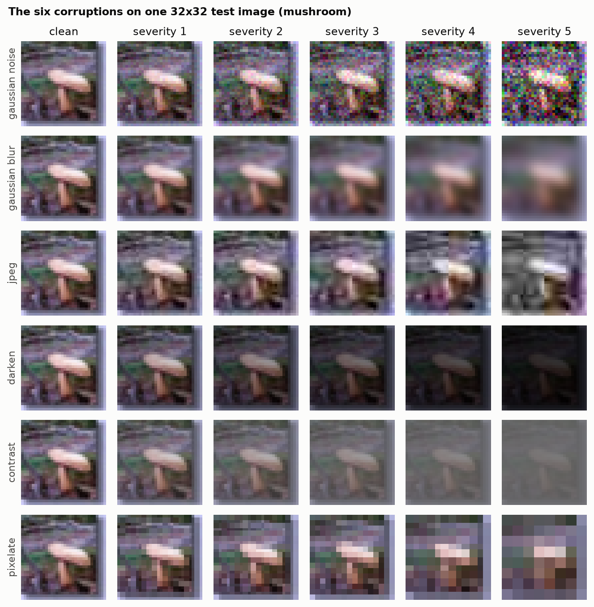
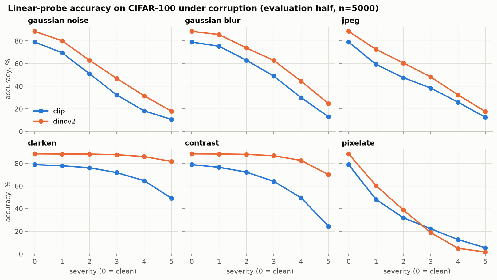
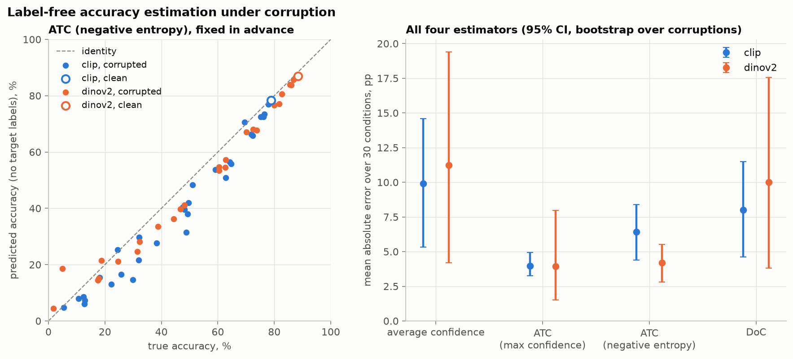
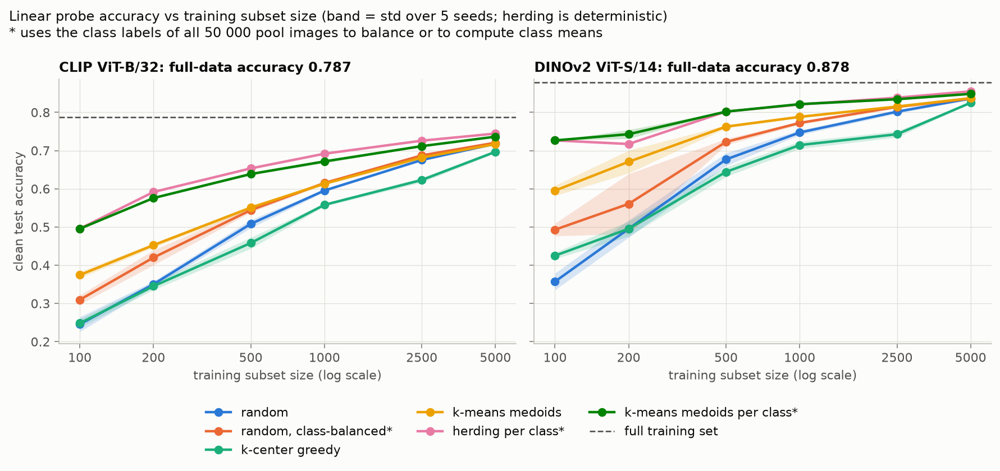
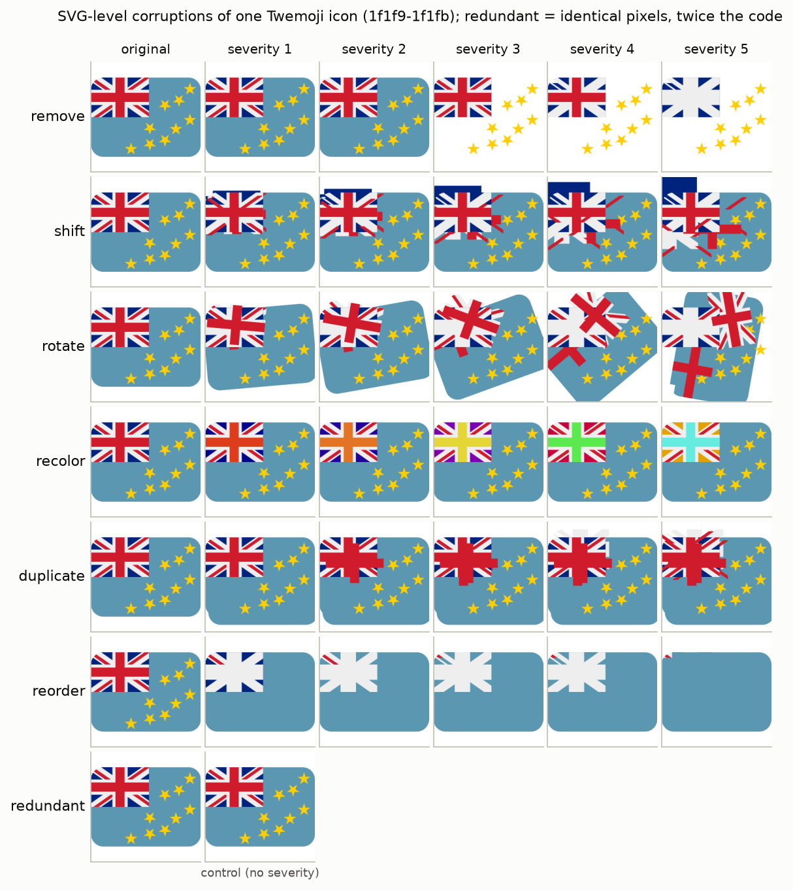
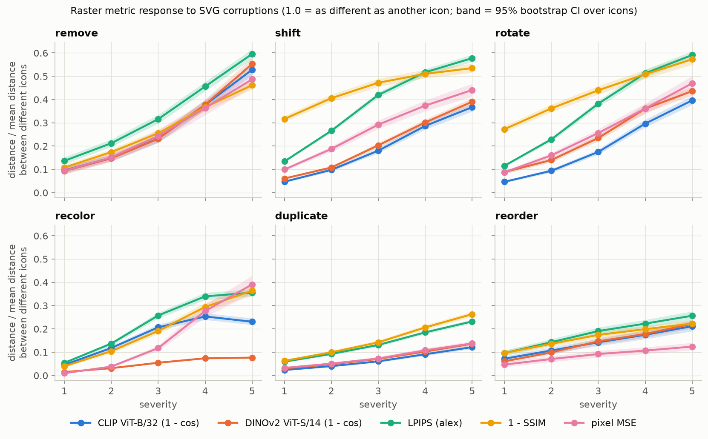

# Замороженные визуальные энкодеры: сдвиг данных, малые выборки и искажения SVG

Сколько можно узнать о замороженном энкодере изображений по линейным пробам и расстояниям в его пространстве эмбеддингов? Здесь сравниваются два небольших предобученных энкодера, CLIP ViT-B/32 и DINOv2 ViT-S/14, на общем наборе эмбеддингов CIFAR-100. Вопросов три.

1. **Сдвиг данных.** Насколько падает точность линейной пробы при шести синтетических искажениях пяти степеней? Насколько хорошо метрики дрейфа эмбеддингов отражают это падение? Можно ли оценить точность без меток целевых данных?
2. **Малые выборки.** Если пробу можно обучить только на 100-5000 картинках, лучше ли выбирать их по геометрии эмбеддингов, чем случайно?
3. **Искажения SVG.** Если вносить искажения прямо в SVG-код иконок Twemoji, растут ли расстояния между эмбеддингами со степенью искажения так же, как пиксельные и перцептивные метрики? К чему нечувствительна каждая метрика?

## Основные результаты

- На чистом CIFAR-100 (оценочная половина теста, n=5000) линейная проба даёт 88,4% на DINOv2 и 78,9% на CLIP. DINOv2 почти не реагирует на контраст и яркость (70,1% против 24,5% при контрасте степени 5, 81,7% против 49,2% при затемнении степени 5), но при сильной пикселизации проигрывает CLIP (5,0% против 12,7% на степени 4, 1,7% против 5,5% на степени 5).
- Внутри каждого энкодера расстояние Фреше между калибровочными и искажёнными эмбеддингами упорядочивает 30 условий по падению точности со Spearman 0,93 для CLIP (95% ДИ 0,87-0,98) и 0,98 для DINOv2 (0,96-0,99). Сама степень искажения даёт только 0,73 и 0,55. Если зафиксировать степень и сравнивать разные искажения, порядок по Фреше сохраняется: средний Spearman 0,90 и 0,95. AUC доменного классификатора выше 0,999 в 21 из 30 условий у CLIP и в 14 из 30 у DINOv2: классификатор насыщается и обнаруживает сдвиг, но сильные искажения между собой почти не различает.
- Оценка точности без меток: у ATC по максимальной уверенности средняя абсолютная ошибка 4,0 п. п. (CLIP) и 3,9 п. п. (DINOv2) по 30 условиям. ATC по отрицательной энтропии (этот вариант я заранее выбрал для графика) ошибается на 6,4 и 4,2 п. п. и для CLIP в среднем занижает точность на 6,3 п. п. Средняя уверенность завышает точность на 9,7 и 11,1 п. п.
- На 100 обучающих картинках herding по классам даёт 49,6% (CLIP) и 72,7% (DINOv2) на чистом тесте, случайный выбор 24,5% и 35,7%. Herding использует метки всех 50 000 картинок пула. Случайный выбор с балансом по классам опирается на те же метки и уже закрывает 6,4 и 13,6 п. п. этого разрыва.
- Лучший метод без меток, медоиды k-means по всему пулу, обгоняет случайный выбор на 12,9 п. п. (CLIP) и 23,8 п. п. (DINOv2) при 100 картинках, но только на 0,7 и 1,3 п. п. при 2500, а при 5000 разница -0,1 и +0,1 п. п. Жадный k-center хуже случайного выбора на всех размерах от 500 (например, -5,0 п. п. у CLIP при 500 и -5,9 п. п. у DINOv2 при 2500).
- Эмбеддинги DINOv2 почти не замечают перекраску SVG: на степени 1 лишь 9,5% иконок выходят за шумовой порог перерендера, у CLIP 82,5%, у LPIPS 99%. На степени 5 расстояние DINOv2 составляет 0,08 от расстояния между двумя разными иконками, у CLIP 0,23.
- Контрольная правка, которая удваивает код и не меняет ни одного пикселя, засчитывается как изменение у 100% иконок обеими метриками по коду и у 0% всеми пятью растровыми. Метрики по коду почти не согласуются с растровыми (|Spearman| не больше 0,13 по всем искажённым образцам), а LPIPS согласуется с CLIP на 0,80 и с DINOv2 на 0,77.
- Хуже всего степень искажения отражается при перестановке порядка элементов: средняя по иконкам корреляция Spearman со степенью 0,73 у CLIP, 0,79 у DINOv2 и 0,85-0,87 у LPIPS, SSIM и MSE. Для остальных искажений и растровых метрик она от 0,81 до 1,00.

Все числа взяты из `results/*.csv` для seed 0.

## Общая постановка

- **Данные**: CIFAR-100 (50 000 train, 10 000 test, 32x32). Внутри обёртки энкодера картинки увеличиваются до 224x224 бикубической интерполяцией.
- **Энкодеры**: `openai/clip-vit-base-patch32` (проецированный эмбеддинг изображения, 512) и `facebook/dinov2-small` (пулинг CLS-токена, 384). Оба заморожены, эмбеддинги нормированы по L2.
- **Проба**: мультиномиальная логистическая регрессия на эмбеддингах, полный батч, L-BFGS. Коэффициент L2-регуляризации подбирается только на части обучающей выборки.
- **Протокол теста**: чётные индексы теста образуют калибровочную половину (её метки можно использовать для порогов, температур и опорных статистик), нечётные образуют оценочную половину (метки нужны только для подсчёта точности).



## Эксперимент 1: сдвиг распределения

**Вопрос.** Сколько точности теряет линейная проба при искажениях и можно ли предсказать эту потерю по метрикам дрейфа на неразмеченных эмбеддингах или оценщиками точности без меток?

**Постановка.**
- Шесть искажений (гауссов шум, гауссово размытие, JPEG, затемнение, контраст, пикселизация) степеней 1-5 применяются к исходным картинкам 32x32 оценочной половины. Получается 30 условий по 5000 картинок.
- Для каждого энкодера одна проба обучена на всех 50 000 обучающих эмбеддингах. Коэффициент регуляризации 1e-6 выбран из сетки 1e-8...1e-3 на 10% обучающей выборки; L-BFGS сошёлся за 205 и 162 итерации.
- Метрики дрейфа между калибровочной половиной и каждым условием: расстояние Фреше (ковариации Ledoit-Wolf), MMD^2 с RBF-ядром (ширина по медиане) и AUC логистического доменного классификатора на кросс-валидации. Порог обнаружения: 99-й перцентиль по 1000 случайным разбиениям чистого теста.
- Оценщики без меток, обученные на калибровочной половине: средняя уверенность после temperature scaling, ATC (Garg et al., 2022) по максимальной уверенности и по отрицательной энтропии, DoC.
- Доверительные интервалы считаются бутстрапом по целым искажениям (все пять степеней вместе), потому что 30 условий не независимы.

**Результаты** (seed 0; MAE по 30 условиям, 95% ДИ в скобках).

| | CLIP ViT-B/32 | DINOv2 ViT-S/14 |
|---|---|---|
| точность на чистой оценочной половине | 78,9% | 88,4% |
| среднее падение точности по 30 условиям | 34,2 п. п. | 30,6 п. п. |
| Spearman(дрейф, падение): Фреше | 0,93 [0,87; 0,98] | 0,98 [0,96; 0,99] |
| Spearman(дрейф, падение): MMD^2 | 0,92 [0,86; 0,97] | 0,98 [0,95; 0,99] |
| Spearman(дрейф, падение): AUC доменного классификатора | 0,84 [0,56; 0,95] | 0,92 [0,85; 0,98] |
| Spearman(степень, падение), базовая линия | 0,73 | 0,55 |
| MAE, ATC по макс. уверенности | 4,0 п. п. [3,3; 4,9] | 3,9 п. п. [1,5; 8,0] |
| MAE, ATC по отриц. энтропии | 6,4 п. п. [4,4; 8,4] | 4,2 п. п. [2,8; 5,5] |
| MAE, DoC | 8,0 п. п. [4,6; 11,5] | 10,0 п. п. [3,8; 17,6] |
| MAE, средняя уверенность | 9,9 п. п. [5,3; 14,6] | 11,2 п. п. [4,2; 19,4] |

У CLIP все три метрики дрейфа превышают свой 99-й перцентиль уже на степени 1 для каждого искажения. У DINOv2 Фреше и MMD^2 впервые ловят затемнение и контраст только на степени 2 (p-значение перестановочного теста для Фреше на степени 1: 0,14 и 0,015), и это согласуется с почти нулевым падением точности там. На чистой оценочной половине ни одна метрика порог не превышает.





**Что это значит.** Энкодеры ломаются по-разному. DINOv2 точнее и устойчивее к фотометрическим изменениям, но когда пропадают мелкие детали, проседает сильнее CLIP. Простые статистики эмбеддингов на неразмеченных данных хорошо упорядочивают условия по потере точности, и дело не только в степени искажения: порядок сохраняется и между разными искажениями одной степени. ATC в среднем ошибается на 4-6 п. п., но на сильных сдвигах ошибка растёт, а лучший вариант у энкодеров разный, так что по этим 30 условиям однозначного победителя среди оценщиков нет.

**Ограничения.** Один seed: одна проба, одно разбиение на калибровку и оценку, одна реализация шума искажений. У калибровочной половины свой разброс (у DINOv2 точность на ней 87,2% против 88,4% на чистой оценочной), и в ДИ оценщиков он не учтён. Пороги обнаружения применяются к 90 тестам без поправки на множественность. Искажения синтетические и накладываются на 32x32 до увеличения.

## Эксперимент 2: малые обучающие выборки

**Вопрос.** Если для обучения пробы доступны от нескольких сотен до нескольких тысяч картинок, лучше ли выбирать их по замороженным эмбеддингам, чем случайно?

**Постановка.**
- Размеры подвыборки 100, 200, 500, 1000, 2500 и 5000 из 50 000 обучающих эмбеддингов; точность на всём чистом тесте (n=10 000).
- Методы без меток: случайный выбор, жадный k-center и медоиды k-means (k равно размеру подвыборки, 30 итераций Ллойда по всему пулу, из каждого кластера берётся ближайший к центру элемент). Методы со звёздочкой используют метки всего пула: случайный выбор с балансом по классам, herding к среднему класса и медоиды k-means внутри класса. Поэтому для них речь об отборе уже размеченных данных, а не об экономии на разметке.
- Коэффициент регуляризации для каждого размера подбирается на случайных подвыборках из отложенной части train (сетка: 0 и 1e-8...1e-2). При 100-500 картинках выбираются 0 или 1e-8, то есть явная L2 там не помогает.
- Пять seed для всех методов, кроме herding: на этих размерах он детерминирован и запускается один раз. При 100 картинках (одна на класс) herding и k-means по классам выбирают одну и ту же точку, ближайшую к среднему класса.

**Результаты** (точность на чистом тесте, среднее по seed, CLIP / DINOv2).

| размер | случайный | k-center | k-means (без меток) | случайный, баланс* | herding* | k-means по классам* |
|---|---|---|---|---|---|---|
| 100 | 24,5 / 35,7 | 24,8 / 42,5 | 37,5 / 59,5 | 31,0 / 49,3 | 49,6 / 72,7 | 49,6 / 72,7 |
| 500 | 50,8 / 67,7 | 45,8 / 64,4 | 55,1 / 76,3 | 54,4 / 72,3 | 65,3 / 80,2 | 63,9 / 80,2 |
| 1000 | 59,5 / 74,7 | 55,8 / 71,4 | 61,3 / 78,8 | 61,5 / 77,2 | 69,2 / 82,1 | 67,2 / 82,2 |
| 5000 | 71,8 / 83,6 | 69,7 / 82,5 | 71,7 / 83,7 | 72,1 / 83,6 | 74,5 / 85,5 | 73,6 / 84,8 |
| 50 000 (всё) | 78,7 / 87,8 | | | | | |

Стандартная ошибка точности на 10 000 тестовых картинок не больше 0,5 п. п., поэтому разницы около 1 п. п. и меньше (например, herding 82,1% против k-means по классам 82,2% у DINOv2 при 1000) статистически не значимы.



**Что это значит.** На совсем маленьких выборках важнее всего покрытие классов и типичность примеров. Один баланс классов уже помогает, а выбор самой типичной картинки каждого класса помогает намного сильнее. С метками пула 5000 картинок после herding сохраняют 94,6% (CLIP) и 97,4% (DINOv2) точности на полных данных. Без меток медоиды k-means хороши при 100-500 картинках, но к 2500-5000 преимущество перед случайным выбором исчезает. Жадный k-center набирает выбросы ради покрытия пространства и мешает линейной пробе на всех размерах от 500. DINOv2 на малых выборках выигрывает от продуманного выбора больше, чем CLIP.

**Ограничения.** Регуляризация подбирается на случайных подвыборках и используется для всех методов. У herding нет разброса по seed, поэтому у его кривой нет полосы. Тестовая выборка одна, парного теста между методами нет. У DINOv2 herding при 200 картинках хуже (71,7%), чем при 100 (72,7%), и там выбрана регуляризация 0; причину я не разбирал.

## Эксперимент 3: искажения на уровне SVG

**Вопрос.** Растут ли расстояния между эмбеддингами монотонно со степенью искажения SVG? Как они соотносятся с пиксельными метриками (MSE, SSIM), перцептивной метрикой (LPIPS) и метриками по коду, и к чему нечувствительна каждая из них?

**Постановка.**
- 400 иконок Twemoji, состоящих только из элементов с плоской заливкой (от 4 до 40 элементов), рендер CairoSVG в 224x224 на белом фоне.
- Шесть видов искажений степеней 1-5: удаление элементов, сдвиг части элементов, поворот части элементов вокруг центра, перекраска части элементов (тон и светлота), дублирование элементов со смещением и перестановка порядка отрисовки. Плюс два контроля: перерендер с двукратным суперсэмплингом (задаёт шумовой порог каждой метрики, его 95-й перцентиль) и *избыточная* копия, где каждый элемент обёрнут во вложенные группы, а в `<defs>` добавлена неиспользуемая копия. Кода становится вдвое больше, пиксели те же, это проверяется тестом.
- Растровые метрики: 1 - косинус для CLIP и DINOv2, LPIPS (AlexNet), 1 - SSIM, пиксельный MSE. Каждая делится на своё среднее расстояние между двумя разными иконками. Метрики по коду: относительное изменение числа листовых элементов и редакционное расстояние по токенам исходника SVG.
- Монотонность: корреляция Spearman между степенью искажения и расстоянием для каждой иконки, усреднённая по иконкам. Чувствительность: доля иконок выше порога перерендера на степени 1.

**Результаты** (доля иконок выше шумового порога перерендера на степени 1).

| метрика | удаление | сдвиг | поворот | перекраска | дублирование | перестановка | избыточный контроль |
|---|---|---|---|---|---|---|---|
| CLIP | 0,79 | 0,88 | 0,85 | 0,83 | 0,57 | 0,65 | 0,00 |
| DINOv2 | 0,66 | 0,80 | 0,80 | 0,10 | 0,36 | 0,59 | 0,00 |
| LPIPS | 0,96 | 1,00 | 1,00 | 0,99 | 0,93 | 0,81 | 0,00 |
| 1 - SSIM | 0,92 | 1,00 | 1,00 | 0,85 | 0,87 | 0,80 | 0,00 |
| пиксельный MSE | 0,96 | 1,00 | 1,00 | 0,99 | 0,94 | 0,82 | 0,00 |
| редакционное расстояние (код) | 1,00 | 1,00 | 1,00 | 1,00 | 1,00 | 1,00 | 1,00 |





**Что это значит.** На чистых рендерах плоских иконок LPIPS и пиксельный MSE для каждого вида искажения чувствительнее и монотоннее, чем расстояния в пространствах обоих энкодеров (SSIM на сдвиге монотонен хуже энкодеров). Энкодеры обучены не замечать многие изменения внешнего вида, а DINOv2 почти полностью игнорирует цвет. Ближе всего к энкодерам LPIPS (Spearman 0,80 с CLIP по всем искажённым образцам), так что из дешёвых метрик его значения лучше всего согласуются с расстояниями между эмбеддингами. Метрики по коду реагируют на любую правку, даже не меняющую пикселей, и никак не различают степени сдвига, поворота и перекраски: для этих трёх редакционное расстояние одинаково на всех уровнях.

**Ограничения.** Степень искажения служит лишь условной заменой воспринимаемого качества, оценок людей нет. Одна реализация искажения на иконку и степень, один seed. Только иконки Twemoji с плоской заливкой; градиенты, обводки и clip path исключены.

## Воспроизведение

Железо: одна ноутбучная NVIDIA T1200 на 4 ГБ (драйвер 535, CUDA 12.2), 16 ядер CPU, 62 ГБ RAM. torch зафиксирован на 2.7.1 (сборка под CUDA 12.6), она работает на драйвере CUDA 12.2 благодаря minor-version compatibility.

```bash
./run_all.sh            # при первом запуске создаёт .venv, гоняет тесты и все эксперименты для SEED=0
SEED=1 ./run_all.sh     # другой seed; искажённые тестовые эмбеддинги пересчитываются
```

Или по шагам:

```bash
python -m pytest -q
python -m veb.embed --seed 0                                  # скачивает CIFAR-100, пишет data/embeddings
CUDA_VISIBLE_DEVICES= python -m veb.exp_shift --seed 0
CUDA_VISIBLE_DEVICES= python -m veb.exp_coreset --seed 0
python -m veb.exp_svg_metrics --seed 0                        # клонирует Twemoji v17.0.3 в data/twemoji
python -m veb.exp_svg_metrics --reuse                         # перерисовывает графики SVG только по results/
```

Время на этом железе: извлечение эмбеддингов около 56 минут (210 000 картинок на энкодер, примерно 125 картинок/с, GPU делился с другими задачами), эксперимент со сдвигом около 11 минут, с малыми выборками около 26 минут, с SVG около 6 минут. Тесты проходят меньше чем за 10 секунд и не требуют GPU, сети и датасетов. Без CUDA `run_all.sh` не запускается, если не задать `ALLOW_CPU=1`. Точные версии пакетов записаны в `requirements.lock`.

## Структура репозитория

```
src/veb/
  common.py           пути, seed, чтение и запись эмбеддингов, линейная проба, бутстрап ДИ
  data.py             загрузка CIFAR-100, контрольная сумма, индексы половин теста
  corruptions.py      шесть искажений CIFAR
  encoders.py         обёртки CLIP и DINOv2, повтор при CUDA OOM
  embed.py            извлечение эмбеддингов для всех выборок
  shift_signals.py    Фреше, MMD, доменный классификатор, temperature scaling, ATC, DoC
  selection.py        методы выбора подвыборки
  svg_data.py         загрузка, фильтрация и рендер Twemoji
  svg_corrupt.py      искажения SVG и избыточный контроль
  exp_shift.py        эксперимент 1
  exp_coreset.py      эксперимент 2
  exp_svg_metrics.py  эксперимент 3
  plotting.py         общий стиль графиков
tests/                быстрые тесты на синтетике
results/              CSV с результатами (svg_metrics.csv.gz: длинная таблица по иконкам)
figures/              графики PNG
run_all.sh            полный прогон
```

`data/` (CIFAR-100, Twemoji, эмбеддинги, около 1,1 ГБ) в git не хранится и пересоздаётся `veb.embed` и `veb.exp_svg_metrics`.

## Ограничения и что дальше

- **Маленькие картинки низкого разрешения.** CIFAR-100 хранится в 32x32 и увеличивается до 224x224, это далеко от разрешения, на котором учились энкодеры. На картинках в родном разрешении результаты могут быть другими.
- **Два небольших энкодера.** Проверены только CLIP ViT-B/32 и DINOv2 ViT-S/14; более крупные модели, модели с другим размером патча или другой задачей предобучения могут вести себя иначе.
- **Синтетический сдвиг.** Искажения лишь приближают реальный сдвиг распределения; естественные сдвиги (новые домены, другие сенсоры, дрейф данных) не проверялись.
- **Нет оценок людей для SVG.** Степень искажения заменяет воспринимаемое качество, поэтому эксперимент с SVG измеряет согласие со степенью, а не с людьми.
- **Только линейные пробы.** Нет дообучения, k-NN и zero-shot классификаторов.
- **Один seed** в экспериментах со сдвигом и SVG; пять seed в эксперименте с малыми выборками (кроме herding).
- Дальше: повторить эксперимент со сдвигом на нескольких пробах и разбиениях калибровки, добавить бенчмарк с естественным сдвигом в родном разрешении, собрать попарные предпочтения людей для искажённых иконок и сравнить с дообученной моделью.

## Данные, модели и лицензии

- **Код**: лицензия MIT, см. `LICENSE`.
- **CIFAR-100**: A. Krizhevsky, *Learning Multiple Layers of Features from Tiny Images*, 2009, https://www.cs.toronto.edu/~kriz/cifar.html. Скачивается при запуске и не распространяется; формальной лицензии на странице датасета нет.
- **Twemoji**: графика из форка jdecked/twemoji, тег v17.0.3, https://github.com/jdecked/twemoji, copyright Twitter, Inc. and other contributors, лицензия CC-BY 4.0 (https://creativecommons.org/licenses/by/4.0/). На `figures/svg_examples.png` показана отрендеренная и изменённая графика Twemoji.
- **CLIP ViT-B/32**: Radford et al., *Learning Transferable Visual Models From Natural Language Supervision*, 2021; веса `openai/clip-vit-base-patch32` с Hugging Face Hub, лицензия MIT.
- **DINOv2 ViT-S/14**: Oquab et al., *DINOv2: Learning Robust Visual Features without Supervision*, 2023; веса `facebook/dinov2-small` с Hugging Face Hub, лицензия Apache 2.0.
- **LPIPS**: Zhang et al., *The Unreasonable Effectiveness of Deep Features as a Perceptual Metric*, 2018; пакет `lpips` (BSD 2-Clause) с признаками AlexNet.
- **ATC**: Garg et al., *Leveraging Unlabeled Data to Predict Out-of-Distribution Performance*, ICLR 2022. **DoC**: Guillory et al., *Predicting with Confidence on Unseen Distributions*, ICCV 2021.
